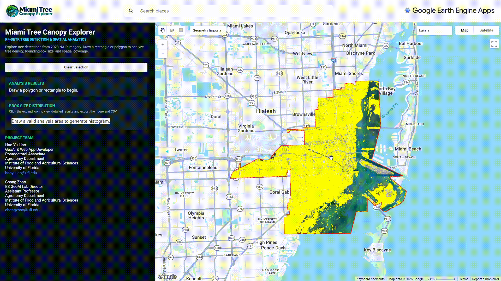

# GeoAI-UrbanTree-RFDETR

Reproducible RF-DETR pipeline for urban tree detection from high-resolution geospatial imagery.

This repository supports the complete workflow from geospatial data preparation to model training, cross-validation, evaluation, transfer testing, and large-area GeoTIFF inference. It can be used either to reproduce the urban-tree experiments in this project or to train and evaluate RF-DETR on a user's own compatible dataset.

[](https://www.python.org/)
[](https://github.com/roboflow/rf-detr)
[](https://pytorch.org/)
[](LICENSE)
[](https://es-geoai.rc.ufl.edu/agroes-miami-tree/)
[](https://earthengine.google.com/)

<!--
[](YOUR_HUGGINGFACE_URL)
[](https://doi.org/10.5281/zenodo.XXXXXXX)
[](YOUR_PREPRINT_URL)
-->

---
## Categories

- [Overview](#overview)
- [Online System](#online-system--miami-tree-canopy-explorer)
- [Quick Start](#quick-start)
- [Installation](#installation)
- [Supported Workflows](#supported-workflows)
- [Dataset Types](#dataset-types)
- [Repository Structure](#repository-structure)
- [Commands](#commands)
- [Configuration Files](#configuration-files)
  - [Dataset Preparation](#1-dataset-preparation-configsdatasetyaml)
  - [TVT Training](#2-tvt-training-configstrainyaml)
  - [Cross-Validation](#3-cross-validation-configscross_validationyaml)
  - [Evaluation](#4-evaluation-configsevaluateyaml)
  - [Large-Area Inference](#5-large-area-inference-configsinferenceyaml)
- [Using Your Own Dataset](#using-your-own-dataset)
- [Model Weights](#model-weights)
- [Outputs](#outputs)
- [Python Package](#python-package)
- [Citation](#citation)
- [License](#license)

---
## Overview

The pipeline is designed around high-resolution geospatial imagery and object-detection labels for individual trees.

Main capabilities include:

- GeoTIFF + vector-label preparation to COCO format
- configurable RGB band selection
- geospatial-to-pixel bounding-box conversion
- standard train / validation / test training
- 5-fold cross-validation
- COCO AP / AR evaluation
- precision / recall / F1 evaluation
- transfer-city evaluation
- image-level RF-DETR prediction through the Python API
- large-area GeoTIFF inference
- conversion of pixel detections back to geospatial coordinates
- export to JSON, GeoJSON, and Shapefile
- YAML-based experiment configuration
- reusable Python modules under `src/geoai_tree/`

---
## Online System — Miami Tree Canopy Explorer

An interactive web application is available for exploring the large-area urban-tree detections produced by this workflow:

<!--
**[Launch the Miami Tree Canopy Explorer](https://es-geoai.rc.ufl.edu/agroes-miami-tree/)**
-->
[](https://es-geoai.rc.ufl.edu/agroes-miami-tree/)

The application provides an interactive geospatial interface for exploring RF-DETR tree detections across the Miami study area. Users can draw a polygon or rectangle over an area of interest to perform spatial analysis of detected trees and inspect bounding-box size distributions for tree canopy cover.

The application connects the model inference outputs with an interactive Google Earth Engine interface, providing a practical demonstration of how large-area GeoAI predictions can be explored and analyzed beyond the command-line workflow.

<p align="center">
  
</p>

> **Note:** The online system demonstrates the Miami tree-detection results generated from the project workflow. The reproducible training, evaluation, and large-area inference pipeline is provided in this repository.

---
## Quick Start

### 1. Create the environment

```bash
conda env create -f environment.yml
conda activate geoai-urbantree-rfdetr
```

or:

```bash
pip install -r requirements.txt
```

### 2. Prepare a geospatial dataset

```bash
PYTHONPATH=src python scripts/prepare_dataset.py \
  --config configs/dataset.yaml
```

### 3. Train the standard TVT model

```bash
PYTHONPATH=src python scripts/train.py \
  --config configs/train.yaml
```

### 4. Run 5-fold cross-validation

```bash
PYTHONPATH=src python scripts/cross_validate.py \
  --config configs/cross_validation.yaml
```

### 5. Evaluate

```bash
PYTHONPATH=src python scripts/evaluate.py \
  --config configs/evaluate.yaml \
  --mode tvt
```

Available evaluation modes:

```text
tvt
cv
transfer
```

### 6. Run large-area GeoTIFF inference

```bash
PYTHONPATH=src python scripts/infer_geotiff.py \
  --config configs/inference.yaml
```

---
## Installation

The repository was tested with:

```text
Python       3.10.19
RF-DETR      1.5.0rc1
PyTorch      2.10.0
Torchvision  0.25.0
NumPy        2.2.6
Pandas       2.3.3
GeoPandas    1.1.3
Rasterio     1.4.4
Shapely      2.1.2
pycocotools  2.0.11
```

### Conda

```bash
conda env create -f environment.yml
conda activate geoai-urbantree-rfdetr
```

### pip

```bash
pip install -r requirements.txt
```

The examples below assume commands are run from the repository root with:

```bash
PYTHONPATH=src
```

---
## Supported Workflows

```text
GeoTIFF imagery + vector tree labels
                │
                ▼
        Dataset preparation
                │
                ▼
          COCO dataset
                │
        ┌───────┴────────┐
        ▼                ▼
     TVT training    5-fold CV
        │                │
        └───────┬────────┘
                ▼
            Evaluation
       ┌────────┼─────────┐
       ▼        ▼         ▼
      TVT       CV     Transfer
                │
                ▼
        Trained EMA weights
                │
                ▼
       Large-area inference
                │
                ▼
   JSON / GeoJSON / Shapefile
```

---
## Dataset Types

The repository uses several dataset organizations depending on the task.

### 1. Raw geospatial imagery

Raw imagery is stored as GeoTIFFs.

```text
datasets/geotiff_rgbn/
├── miami_030/
├── new_york_030/
├── chicago_030/
├── dallas_060/
└── los_angeles_060/
```

The suffix indicates the nominal imagery resolution used in this project:

```text
030 → 0.30 m imagery
060 → 0.60 m imagery
```

The dataset-preparation pipeline reads three configurable bands, with RGB bands `1, 2, 3` used by default.

---

### 2. Vector tree labels

Tree-label files are stored separately from imagery.

```text
datasets/labels/
├── miami_030/
├── new_york_030/
├── chicago_030/
├── dallas_060/
└── los_angeles_060/
```

Example Shapefile components:

```text
labels_new_york_030.shp
labels_new_york_030.shx
labels_new_york_030.dbf
labels_new_york_030.prj
labels_new_york_030.cpg
```

The preparation pipeline automatically reprojects vector labels to the raster CRS when needed.

---

### 3. Standard train / validation / test COCO dataset

The main RF-DETR training dataset uses:

```text
datasets/coco/tvt/
├── train/
│   ├── images/
│   └── _annotations.coco.json
├── valid/
│   ├── images/
│   └── _annotations.coco.json
└── test/
    ├── images/
    └── _annotations.coco.json
```

This dataset is used by:

```text
scripts/train.py
scripts/evaluate.py --mode tvt
```

---

### 4. Cross-validation dataset

The 5-fold cross-validation dataset uses:

```text
datasets/coco/cv/
├── fold_1/
│   ├── train/
│   └── valid/
├── fold_2/
│   ├── train/
│   └── valid/
├── fold_3/
│   ├── train/
│   └── valid/
├── fold_4/
│   ├── train/
│   └── valid/
└── fold_5/
    ├── train/
    └── valid/
```

Each `train/` and `valid/` directory contains:

```text
images/
_annotations.coco.json
```

This dataset is used by:

```text
scripts/cross_validate.py
scripts/evaluate.py --mode cv
```

---

### 5. Transfer-city datasets

Transfer datasets evaluate a trained model on geographically independent cities.

```text
datasets/coco/transfer/
├── new_york_030/
│   └── test/
├── chicago_030/
│   └── test/
├── dallas_060/
│   └── test/
└── los_angeles_060/
    └── test/
```

Each `test/` directory contains:

```text
images/
_annotations.coco.json
```

This dataset is used by:

```bash
PYTHONPATH=src python scripts/evaluate.py \
  --config configs/evaluate.yaml \
  --mode transfer
```

---
## Repository Structure

```text
GeoAI-UrbanTree-RFDETR/
├── configs/
│   ├── train.yaml
│   ├── cross_validation.yaml
│   ├── evaluate.yaml
│   ├── inference.yaml
│   └── dataset.yaml
│
├── datasets/
│   ├── geotiff_rgbn/
│   ├── labels/
│   └── coco/
│
├── outputs/
│
├── scripts/
│   ├── train.py
│   ├── cross_validate.py
│   ├── evaluate.py
│   ├── infer_geotiff.py
│   └── prepare_dataset.py
│
├── src/
│   └── geoai_tree/
│       ├── data/
│       ├── training/
│       ├── evaluation/
│       ├── inference/
│       ├── visualization/
│       └── utils/
│
├── weights/
│   ├── tvt/
│   └── cv/
│
├── requirements.txt
├── environment.yml
├── CITATION.cff
├── LICENSE
└── README.md
```

---
## Commands

### Dataset preparation

```bash
PYTHONPATH=src python scripts/prepare_dataset.py \
  --config configs/dataset.yaml
```

### Standard TVT training

```bash
PYTHONPATH=src python scripts/train.py \
  --config configs/train.yaml
```

### Cross-validation

Train all folds:

```bash
PYTHONPATH=src python scripts/cross_validate.py \
  --config configs/cross_validation.yaml
```

Train one fold:

```bash
PYTHONPATH=src python scripts/cross_validate.py \
  --config configs/cross_validation.yaml \
  --fold 3
```

Train selected folds:

```bash
PYTHONPATH=src python scripts/cross_validate.py \
  --config configs/cross_validation.yaml \
  --folds 1 3 5
```

### Evaluation

TVT:

```bash
PYTHONPATH=src python scripts/evaluate.py \
  --config configs/evaluate.yaml \
  --mode tvt
```

Cross-validation:

```bash
PYTHONPATH=src python scripts/evaluate.py \
  --config configs/evaluate.yaml \
  --mode cv
```

Transfer cities:

```bash
PYTHONPATH=src python scripts/evaluate.py \
  --config configs/evaluate.yaml \
  --mode transfer
```

### Large-area inference

```bash
PYTHONPATH=src python scripts/infer_geotiff.py \
  --config configs/inference.yaml
```

---
## Configuration Files

All major workflows are controlled through YAML files so that dataset paths, training settings, evaluation thresholds, and output locations can be changed without editing the Python source code.

---
## Using Your Own Dataset

There are two main ways to use your own data.

### Option A: Start from GeoTIFF + vector labels

Prepare:

```text
your imagery/*.tif
your labels.shp
```

Update:

```text
configs/dataset.yaml
```

and run:

```bash
PYTHONPATH=src python scripts/prepare_dataset.py \
  --config configs/dataset.yaml
```

This creates an RF-DETR-compatible COCO dataset.

---

### Option B: Start from an existing COCO dataset

If your dataset already uses COCO object-detection format, organize it as:

```text
my_dataset/
├── train/
│   ├── images/
│   └── _annotations.coco.json
├── valid/
│   ├── images/
│   └── _annotations.coco.json
└── test/
    ├── images/
    └── _annotations.coco.json
```

Then change:

```yaml
dataset:
  root: datasets/coco/my_dataset
```

in:

```text
configs/train.yaml
```

and train:

```bash
PYTHONPATH=src python scripts/train.py \
  --config configs/train.yaml
```

The shared trainer validates the required directory structure before training starts.

---
## Model Weights

Released model weights use the EMA checkpoint:

```text
checkpoint_best_ema.pth
```

Expected structure:

```text
weights/
├── tvt/
│   └── checkpoint_best_ema.pth
└── cv/
    ├── fold_1/
    │   └── checkpoint_best_ema.pth
    ├── fold_2/
    │   └── checkpoint_best_ema.pth
    ├── fold_3/
    │   └── checkpoint_best_ema.pth
    ├── fold_4/
    │   └── checkpoint_best_ema.pth
    └── fold_5/
        └── checkpoint_best_ema.pth
```

Large model weights are not stored directly in the Git repository and can be distributed separately through Zenodo.

---
## Outputs

### Training

```text
outputs/training/tvt/
```

### Cross-validation

```text
outputs/cross_validation/
```

### Evaluation

```text
outputs/evaluation/
├── tvt/
├── cv/
└── transfer/
```

Typical evaluation split output:

```text
metrics_per_image.csv
summary.json
summary.txt
prediction COCO JSON
vis_gt_left__pred_right/
```

### Large-area inference

```text
outputs/inference/miami_030/full_aoi/
```

Typical outputs:

```text
miami_030_rfdetr_predictions.json
miami_030_rfdetr_predictions.geojson
miami_030_rfdetr_predictions.shp
miami_030_rfdetr_predictions.shx
miami_030_rfdetr_predictions.dbf
miami_030_rfdetr_predictions.prj
miami_030_rfdetr_predictions.cpg
summary.json
```

---
## Python Package

Reusable functionality is implemented under:

```text
src/geoai_tree/
```

### `data/`

```text
coco.py
geospatial.py
preparation.py
validation.py
```

Responsibilities:

- COCO parsing
- image-path resolution
- raster-window creation
- geospatial coordinate conversion
- GeoTIFF-to-COCO preparation
- dataset validation

### `training/`

```text
trainer.py
cross_validation.py
```

Responsibilities:

- shared RF-DETR training
- TVT training
- CV fold training
- CV orchestration

### `evaluation/`

```text
detection_metrics.py
coco_metrics.py
evaluator.py
```

Responsibilities:

- IoU matching
- TP / FP / FN
- precision / recall / F1
- COCO AP / AR
- split evaluation
- result summaries

### `inference/`

```text
predictor.py
raster_inference.py
```

Responsibilities:

- RF-DETR checkpoint loading
- image prediction
- confidence filtering
- COCO prediction conversion
- tiled raster inference
- map-coordinate prediction export

### `visualization/`

```text
detection.py
```

Responsibilities:

- bounding-box drawing
- GT / prediction side-by-side visualization

### `utils/`

```text
config.py
paths.py
checkpoints.py
```

Responsibilities:

- YAML configuration loading
- repository-relative path resolution
- model-checkpoint resolution

---
## Citation

If you use this repository in research, please cite the associated publication and software release.

Citation metadata is provided in:

```text
CITATION.cff
```

The Zenodo DOI for archived software, datasets, and model weights can be added after the public archive is created.

---
## License

This project is released under the MIT License.

See:

```text
LICENSE
```

for details.
